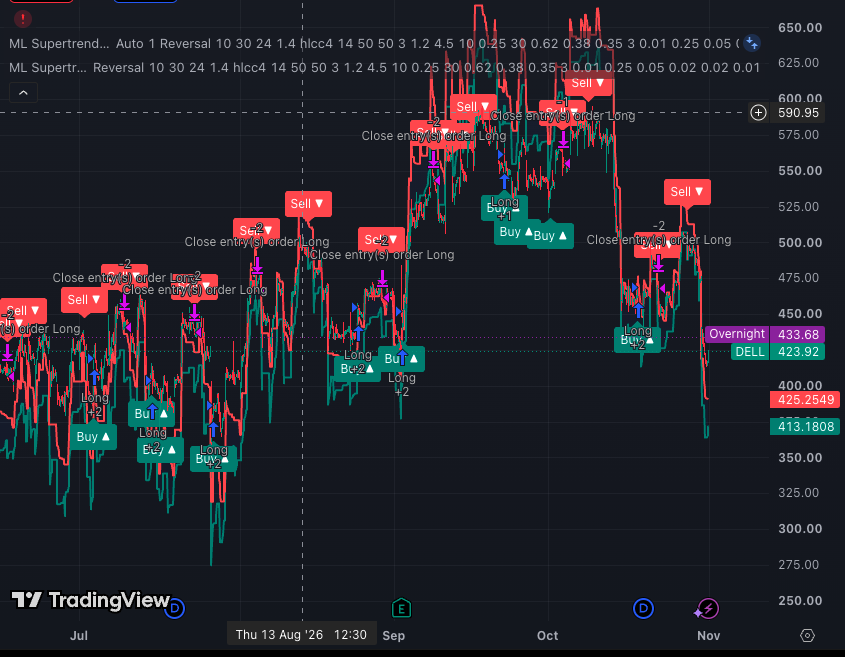
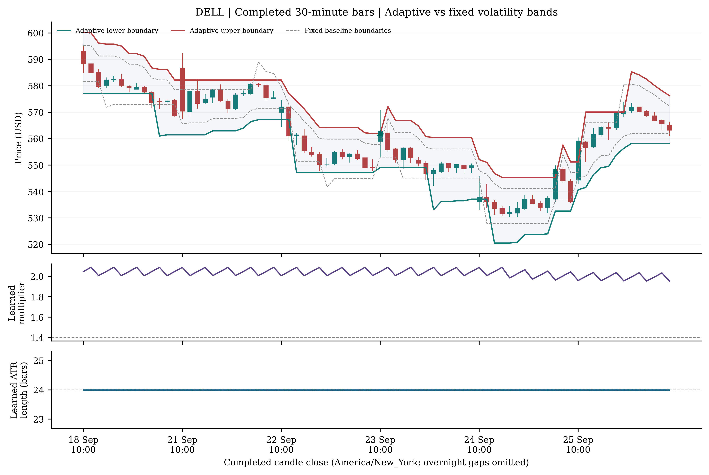
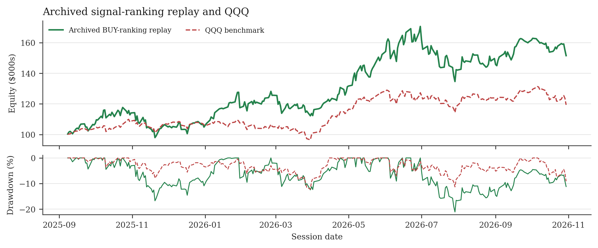
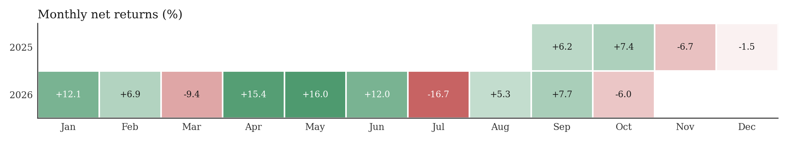
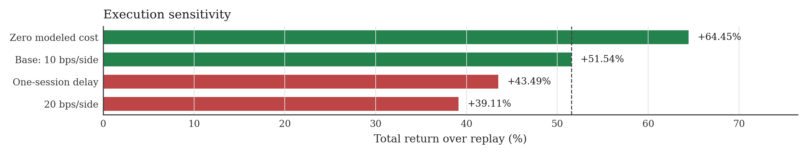
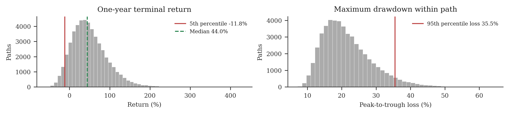

# ML Supertrend

[Strategy declaration](reports/Strategy_Declaration.pdf) · [Direct 30-minute replay](docs/DIRECT_MODEL_BACKTEST.md) · [Rubric self-assessment](docs/IQIC_RUBRIC_REVIEW.md) · [Archived-ranking replay](docs/BACKTEST.md) · [Repository layout](docs/REPOSITORY.md) · [Bands-only Pine overlay](tradingview/ml_supertrend_bands_only.pine)

Juneja Street's adaptive reversal signal engine, using machine learning to train indicator settings as completed market candles arrive. It runs hypothetical long and short positions in the background, scores their completed outcomes, and uses that feedback to adjust how quickly a volatility-based indicator responds to price.

The declared account is long-only. Hypothetical shorts supply learning observations; a SELL signal closes an existing long. The learner changes indicator settings and internal blend weights. It does not choose a stock's portfolio allocation.

## Run on your own market bars

Python 3.11 or later:

```sh
python -m venv .venv
source .venv/bin/activate
python -m pip install -r requirements.txt
python run_signals.py /path/to/completed_30m_bars.csv
python run_signals.py /path/to/completed_30m_bars.csv --fixed --output outputs/fixed_signals.csv
python -m unittest discover -s tests -v
```

Supply provider-sourced completed OHLCV bars under the input contract below. No generated price dataset is included. The runner emits signals; it does not submit orders or calculate a portfolio return. `examples/WORKED_EXAMPLES.md` explains the calculations without manufacturing a market history.

## How it learns

1. Open small hypothetical long and short probes at candle opens, subject to the internal learning gates. Up to five per direction can overlap.
2. At the close of each probe's fifth candle, record its directional gain, gain divided by entry volatility, and worst adverse movement.
3. Summarize recent results. Rolling results provide slower feedback; small batches provide faster feedback and reduce the influence of tests with large adverse moves.
4. Recall results from an 8 × 8 grid describing trend/range conditions and relative volatility. More observations increase the grid's influence, within a fixed cap.
5. Blend proposals, round targets, enforce bounds and move settings gradually. Completed outcomes are available before they can affect a new signal.
6. Generate reversal signals from the adjusted envelope, fresh extremes, RSI and signal spacing. Apply position and portfolio risk limits separately.

This is an adaptive system built from explicit update rules and contextual memory. It is not a neural network or a calibrated probability model. An adaptive-vs-fixed, cost-aware portfolio replay is still required to establish whether the learning improves investment results.

## Contents

| Path | Purpose |
| --- | --- |
| `src/ml_supertrend.py` | Python research signal engine; offline imports only |
| `tradingview/ml_supertrend.pine` | Pine v5 research strategy snapshot |
| `tradingview/ml_supertrend_bands_only.pine` | Separate, independently toggleable bands overlay; no trade markers |
| `tradingview/ml_supertrend_visual.pine` | Alias of the bands-only overlay |
| `run_signals.py` | Validated, single-symbol CSV runner |
| `config/declaration.json` | Declared signal and portfolio settings |
| `docs/STRATEGY.md` | Data → signal → portfolio decision |
| `docs/LEARNING.md` | Probe labels, proposal weights, context memory and updates |
| `docs/VARIABLES.md` | Formula glossary and worked examples |
| `docs/VALIDATION.md` | Evidence scope and remaining checks |
| `docs/BACKTEST.md` | Archived BUY-list replay, costs, timing and reproduction |
| `analysis/replay_archived_signals.py` | Offline saved-ranking portfolio replay |
| `analysis/plot_archived_replay.py` | Rebuild the replay equity, drawdown, monthly-return, daily-return and shrinkage-correlation charts |
| `analysis/results/archived_replay/` | Dated rankings, simulated outputs and sensitivity tests |
| `docs/EXECUTION.md` | Bar timing, state, fills and risk overlay |
| `docs/ATTRIBUTION.md` | Code origin and external references |
| `docs/TRADINGVIEW.md` | Add, hide or show the bands-only Pine overlay |
| `analysis/run_risk.py` | Assumption-based Monte Carlo on declared exposures |
| `analysis/monte_carlo_archived_replay.py` | Run a five-session block bootstrap on the archived ML Supertrend BUY-email replay |
| `analysis/check_model.py` | Parameter sensitivity and chronological-prefix checks on real input bars |
| `docs/RISK_TESTS.md` | Risk assumptions, formulas and completed results |
| `docs/ML_SUPERTREND_MONTE_CARLO.md` | Monte Carlo method and results from the one-year ML Supertrend email archive |

The repository includes historical simulated replay outputs and normalized dated BUY rankings. It contains no private broker-account ledger, credentials, mail contents, broker configuration or raw market-data cache.

## Input contract

CSV columns: `time,open,high,low,close,volume`. One symbol and timeframe per file. `time` is a completed candle's close timestamp with an explicit timezone. Supply regular-session 30-minute bars in increasing order, with consistent corporate-action treatment and a fixed initialization history. The runner rejects invalid prices, duplicate or future timestamps and fewer than 100 candles. It cannot independently know whether your provider has finalized a candle or adjusted a split correctly.

## Research boundaries

The Python engine resets at the start of every `run()`. Its exported snapshot is partial and cannot resume a full live history. Pine/Python signal parity has not been established. The Pine snapshot includes a basic strategy order wrapper; it does not implement the declaration's complete position sizing, stops, sector caps or account drawdown controls. Its default tick-pressure setting is ON: turn it OFF for the declared baseline. Historical/realtime behaviour and broker fills require separate validation.

## DELL paper-trading chart



Team TradingView screenshot of the DELL 30-minute paper-trading session, July-November 2026. BUY, SELL and close-order labels show plotted signal timing against price. The strategy declaration reports the separate archived portfolio replay. [Open the Strategy Declaration](reports/Strategy_Declaration.pdf).

## Real-market chart



The following code-generated chart uses Yahoo Finance DELL regular-session 30-minute bars, 18-25 September 2026, from an existing provider cache; full initialization starts 2 July 2026. It is a Python indicator replay. Input checksum and timestamps are recorded in `docs/images/chart_provenance.json`. The chart shows bands and parameter state; it does not claim the learned settings beat fixed settings.

To plot your own provider-sourced bars:

```sh
python -m pip install -r requirements-plot.txt
python examples/plot_market.py /path/to/completed_30m_bars.csv --symbol DELL --provider "Your data provider"
```

## Bands overlay verified in TradingView

The preferred chart file is `tradingview/ml_supertrend_bands_only.pine`. It was compiled, run and toggled off/on on a DELL 30-minute chart. It displays bands without adding BUY/SELL markers or orders. `docs/TRADINGVIEW.md` has the copy/paste and eye-toggle instructions.

## ML Supertrend archived BUY-email backtest

[Method and reproduction](docs/BACKTEST.md) · [Results](analysis/results/archived_replay/) · [Strategy declaration](reports/Strategy_Declaration.pdf)

8 September 2025–30 October 2026, $100,000 starting capital:

| Execution assumption | Total return | Max drawdown |
| --- | ---: | ---: |
| Zero modeled cost | +64.45% | -19.47% |
| 10 bps per side | +51.54% | -21.10% |
| 20 bps per side | +39.11% | -22.81% |
| 10 bps + one extra session for ranking eligibility | +43.49% | -21.91% |

The archived replay finished above QQQ, with a 21.10% maximum drawdown. Nine of 14 months were positive; the largest monthly loss was 16.7%. The sensitivity chart compares the same replay under higher costs and a one-session delay. In the resampled one-year paths, the median return was positive, 10.87% ended below the starting value, and the 5th-percentile return was -11.85%.







[Monte Carlo method and results](docs/ML_SUPERTREND_MONTE_CARLO.md).

These archived BUY emails were generated by the ML Supertrend. The replay applies each saved list at the next session open; the last list carries forward after 14 October. All 1,254 fills and 290 daily marks reproduce the saved ledger. The five-position rules in the declaration govern current portfolio sizing.
