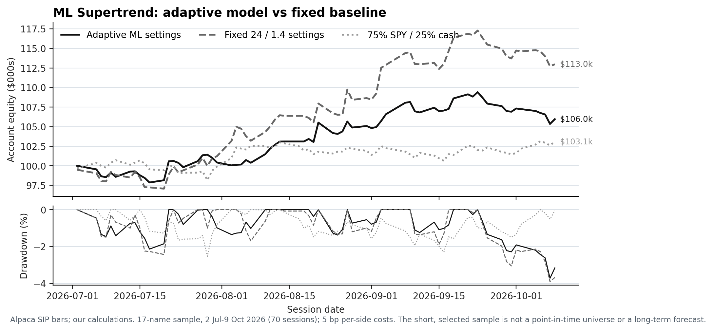

# Direct 30-minute portfolio replay

This replay applies the declared signal engine and portfolio overlay directly to historical intraday bars. It is separate from the archived daily BUY-ranking replay in [BACKTEST.md](BACKTEST.md).

## Test window and data

- Signal warm-up: Alpaca SIP 30-minute OHLCV, 1 June–9 October 2026.
- Evaluation: 2 July–9 October 2026, 70 regular-session trading days.
- Sample: 17 stocks with complete cached bars plus SPY for the benchmark. The sample is not a point-in-time S&P 500 universe; it is selected and short. Results do not establish a long-run edge.
- Only 09:30–16:00 America/New_York bars are used. Input timestamps must be unique and increasing; invalid OHLCV and nonmatching timestamps fail the run. No price gaps are filled.
- Provider input hashes are recorded in `analysis/results/declared_portfolio/provenance.json`. Raw provider bars are not redistributed.

## Rules and execution

The public `MLSupertrend` engine runs sequentially on completed bars with Reversal mode and tick pressure off. The adaptive case enables online probe learning. The fixed comparison uses the same signal engine and settings except that adaptation is disabled; ATR length remains 24 and the baseline multiplier remains 1.4. A signal confirmed at a candle close is filled at the next available 30-minute open.

This historical simulation used a long-only portfolio, one position per name, at most five names, 15% of equity per name, 75% gross exposure, 20% per sector and 25% for the technology cluster. Shares are rounded down. The order is capped by a 0.5% per-name and 2% aggregate planned-loss budget using a stop two ATR(24) below entry. A new position must pass the $5 price floor and a $20 million trailing 20-session average dollar-volume threshold. Signals with the same timestamp are processed alphabetically. Exits occur at the next open after a confirmed SELL; protective stops fill at the stop or at a worse opening price after a gap. A 2% session loss pauses new entries for the rest of that session; a 6% peak drawdown liquidates at the next available open and halts the run.

Fills include 5 basis points of adverse friction per side; 10 basis points per side is the cost sensitivity. Equity is marked at each session close. There is no borrowing, cash interest, dividend adjustment, or invented final liquidation. The benchmark invests 75% of initial capital in SPY at the first test open and holds cash for the rest; entry friction is included, but dividends are omitted.

## Results

| Portfolio | Cost per side | Return | Max drawdown | Daily Sharpe (0% cash rate) | Closed trades | Win rate | Profit factor | Average gross exposure |
|---|---:|---:|---:|---:|---:|---:|---:|---:|
| Adaptive settings | 5 bp | +5.95% | -3.71% | 1.94 | 70 | 37.14% | 1.55 | 22.06% |
| Fixed ATR(24) / 1.4 | 5 bp | +12.97% | -3.89% | 2.97 | 97 | 34.02% | 1.89 | 26.21% |
| 75% SPY / 25% cash | 5 bp | +3.08% | -2.52% | 1.39 | — | — | — | 75.11% |
| Adaptive settings | 10 bp | +4.22% | -3.80% | 1.40 | 72 | 34.72% | 1.34 | 21.96% |
| Fixed ATR(24) / 1.4 | 10 bp | +11.50% | -3.77% | 2.63 | 94 | 29.79% | 1.76 | 26.03% |
| 75% SPY / 25% cash | 10 bp | +3.04% | -2.52% | 1.37 | — | — | — | 75.14% |

The adaptive portfolio beat the cash-matched benchmark in this sample but returned less than the fixed-setting comparison. It therefore does not show that online adaptation adds performance. The 75% figure is a ceiling: realized average exposure was 22.06% for the adaptive case because position-level risk and other limits often bound size. The 6% drawdown halt did not trigger in this sample.



## Files and reproduction

- `analysis/replay_declared_portfolio.py`: bar validation, sequential signal generation and portfolio execution.
- `analysis/plot_declared_portfolio.py`: equity and drawdown chart.
- `analysis/results/declared_portfolio/summary.csv`: all summary metrics.
- `analysis/results/declared_portfolio/*_daily.csv`: daily marked equity and exposure.
- `analysis/results/declared_portfolio/*_trades.csv`: closed trade ledger.
- `analysis/results/declared_portfolio/*_monthly.csv`: compounded monthly returns.
- `analysis/results/declared_portfolio/equity_drawdown.png`: adaptive, fixed and benchmark comparison.

Supply one `SYMBOL_30Min.csv` file per name plus `SPY_30Min.csv`, with columns `time,open,high,low,close,volume` and timezone-aware timestamps. The fixed sample is named in `provenance.json`.

```sh
python -m pip install -r requirements.txt
python analysis/replay_declared_portfolio.py /path/to/alpaca_bars \
  --output-dir analysis/results/declared_portfolio
python -m pip install -r requirements-plot.txt
python analysis/plot_declared_portfolio.py analysis/results/declared_portfolio
```

This is a short historical simulation on a selected sample, not a live record, a point-in-time universe test, or a forecast.
